<!--
  GENERATED by scripts/build_profile.py. Do not edit by hand.
  Edit profile.config.json, then run:
      python3 scripts/fetch_stats.py && python3 scripts/build_profile.py
  The "Refresh profile" GitHub Action does this every day.
-->

<a href="https://angelvalladares.dev"><picture><source media="(prefers-color-scheme: dark)" srcset="assets/profile/hero-dark.svg"></picture></a>

<picture><source media="(prefers-color-scheme: dark)" srcset="assets/profile/about-dark.svg"></picture>

<picture><source media="(prefers-color-scheme: dark)" srcset="assets/profile/title-work-dark.svg"></picture>
<a href="https://airplx.com"><picture><source media="(prefers-color-scheme: dark)" srcset="assets/profile/project-0-dark.svg"></picture></a>
<a href="https://airplx.com"><picture><source media="(prefers-color-scheme: dark)" srcset="assets/profile/project-1-dark.svg"></picture></a>
<a href="https://www.pinkysstorehn.com/"><picture><source media="(prefers-color-scheme: dark)" srcset="assets/profile/project-2-dark.svg"></picture></a>
<a href="https://github.com/angeldev96/tailwind-aspdotnet"><picture><source media="(prefers-color-scheme: dark)" srcset="assets/profile/project-3-dark.svg"></picture></a>

<picture><source media="(prefers-color-scheme: dark)" srcset="assets/profile/experience-dark.svg"></picture>

<picture><source media="(prefers-color-scheme: dark)" srcset="assets/profile/stack-dark.svg"></picture>

<picture><source media="(prefers-color-scheme: dark)" srcset="assets/profile/title-contact-dark.svg"></picture>
<a href="https://angelvalladares.dev/en"><picture><source media="(prefers-color-scheme: dark)" srcset="assets/profile/contact-website-dark.svg"></picture></a>
<a href="https://www.linkedin.com/in/angel-valladares-422490159"><picture><source media="(prefers-color-scheme: dark)" srcset="assets/profile/contact-linkedin-dark.svg"></picture></a>
<a href="https://x.com/angeldev96"><picture><source media="(prefers-color-scheme: dark)" srcset="assets/profile/contact-x-dark.svg"></picture></a>
<a href="mailto:arivalladares2.0@gmail.com"><picture><source media="(prefers-color-scheme: dark)" srcset="assets/profile/contact-email-dark.svg"></picture></a>

